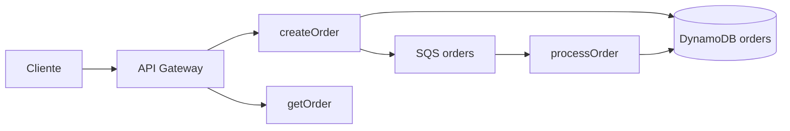

# Pedidos Express

Lab de um serviço de pedidos em Node.js utilizando arquitetura serverless AWS. A API grava o pedido e devolve na hora; a confirmação acontece depois, numa Lambda ligada a uma fila. Tudo roda no LocalStack, sem conta AWS.

`POST /orders` valida o payload, grava o pedido com status `RECEIVED` no DynamoDB e publica o `orderId` no SQS. A Lambda `process-order` consome a fila e atualiza o mesmo item para `CONFIRMED` ou `REJECTED`. `GET /orders/{orderId}` lê o estado atual.

A regra da confirmação fica só no consumidor da fila: quantidade menor ou igual a zero recusa o pedido; total acima de R$ 500,00 (50000 centavos) também recusa; o restante é confirmado.



## Pré-requisitos

- Docker em execução
- Node.js 20 ou mais recente

A imagem é `localstack/localstack:4.14.0`, a última tag Community que sobe sem token de autenticação.

## Subir

```bash
npm install
npm run up
npm run build
npm run provision
npm run demo
```

`npm run up` sobe o container e espera o health em `http://127.0.0.1:4566/_localstack/health`. `npm run build` gera um zip por função em `dist/`. `npm run provision` cria os recursos e pode ser executado de novo: tabela, fila, role e funções existentes são reaproveitadas, e o zip é atualizado. `npm run demo` cria um pedido de R$ 30,00 e espera `CONFIRMED`, depois um de R$ 600,00 e espera `REJECTED`.

A primeira invocação baixa a imagem do runtime `nodejs20.x`. Se o `POST` estourar o tempo enquanto essa imagem chega, rode `npm run demo` outra vez.

Para parar e apagar o container:

```bash
npm run down
```

## Recursos

O provisionamento fala com `http://127.0.0.1:4566` usando as credenciais de lab `test` / `test`, região `us-east-1`.

- Tabela DynamoDB `orders`, chave `orderId`, cobrança sob demanda
- Fila SQS `orders`, visibility timeout de 30 segundos
- Role `orders-lambda-role`, com leitura e escrita na tabela, `sqs:SendMessage` para a criação e consumo da fila para o processamento
- Lambdas `create-order`, `process-order` e `get-order` em `nodejs20.x`
- Event source mapping da fila para `process-order`, lote de 1, com falha parcial de lote
- API REST `orders-api`, stage `dev`, `POST /orders` e `GET /orders/{orderId}`

A URL local fica em `dist/api.json`, no formato `http://127.0.0.1:4566/restapis/<apiId>/dev/_user_request_`.

As Lambdas recebem `AWS_ENDPOINT_URL=http://localhost.localstack.cloud:4566`. O SDK usa esse endpoint quando a variável existe e o endpoint padrão da AWS quando ela não existe. A URL da fila gravada na função aponta para o mesmo host, porque o cliente do SQS chama o host que está na URL da fila.

O container da Lambda entra na rede `aws-lab_default` (`LAMBDA_DOCKER_NETWORK`). O socket do Docker está montado no LocalStack para ele criar esses containers.

O passo a passo com AWS CLI, fase por fase, está no [estudo.md](estudo.md). A página que desenha o caminho do pedido sobe com `npm run ui` em `http://127.0.0.1:5173`.

## O mesmo código na AWS

Os handlers não têm URL da AWS escrita no código. Na conta real, o zip de `dist/` sobe do mesmo jeito e a função deixa de receber `AWS_ENDPOINT_URL`. A URL da fila passa a ser a URL de verdade, e a role deixa de usar a conta `000000000000`. O stage do API Gateway deixa de ser o caminho `/_user_request_` do LocalStack.
